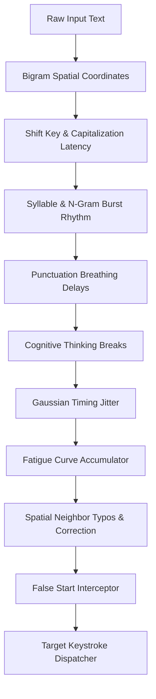

# Helpotron Unified Accessibility Typing Engine

> **Assistive Technology Specification & Implementation Manual**  
> Designed for individuals with motor impairments, Repetitive Strain Injury (RSI), essential tremor, spinal cord injuries, and dysgraphia.

---

## 1. Overview & Accessibility Mission

The **Helpotron Unified Accessibility Typing Engine** provides an authentic, human-paced keystroke synthesis system that allows students with fine motor limitations, cognitive fatigue, or physical disabilities to have their generated academic assignments, essays, and notes typed into document editors (Google Docs, Gmail, Notion, Microsoft Word Online, Canvas LMS) at a comfortable, natural cadence.

The system combines best-in-class methodologies from five foundational open-source typing projects into a single, cohesive browser companion and programmatic API:

| Project Source | Key Integrated Architecture |
|---|---|
| **Dripwriter Origin** | Programmatic API (`window._dripwriter`), false start simulation, cognitive micro-breaks |
| **Eztypr** | Canvas iframe keystroke injection (`.docs-texteventtarget-iframe`), static/base keypress timing |
| **nukerai** | 9-dimension realism framework (Gaussian jitter, punctuation pauses, thinking breaks, burst rhythm, fatigue curves, bigram timing) |
| **Lucy BD** | Cross-tab persistent draggable HUD, OS-level Chrome Debugger API integration with fallback |
| **Auto-Type (GitLitAF)** | Spatial QWERTY keyboard neighbor typo matrix, multi-target editor compatibility |

---

## 2. The 9 Dimensions of Realism & Physical Keyboard Model

The engine models human typing kinetics using 9 interrelated physiological dimensions:



### 1. Base WPM Calculation
$$\text{Base Delay per Character} = \frac{60{,}000\,\text{ms}}{\text{WPM} \times 5} = \frac{12{,}000}{\text{WPM}}\,\text{ms}$$
Configurable from **20 WPM** (RSI recovery) to **140 WPM** (brisk).

### 2. Bigram Physical Distance
The engine maintains a 2D Euclidean coordinate map of standard QWERTY keyboards:
$$d = \sqrt{(x_2 - x_1)^2 + (y_2 - y_1)^2}$$
Keys further apart across rows or hands incur realistic physical travel latency ($+15\text{--}40\,\text{ms}$).

### 3. Shift Key & Capitalization Overhead
Capital characters (`A-Z`) and upper symbols (`!`, `@`, `#`) incur $+45\text{--}90\,\text{ms}$ Shift-press / hold latency.

### 4. Burst Rhythm on Common N-Grams
Common syllables and high-frequency English n-grams (`the`, `and`, `ing`, `tion`, `that`, `with`, `for`, `ment`) are typed **28% faster** in rapid motor bursts.

### 5. Punctuation Breathing Pauses
- **Minor Punctuation** (`,`, `;`, `:`, `--`): $+120\text{--}280\,\text{ms}$ breath pause.
- **Major Sentence Terminators** (`.`, `!`, `?`): $+380\text{--}750\,\text{ms}$ clause boundary pause.
- **Paragraph Breaks** (`\n\n`): $+800\text{--}1600\,\text{ms}$ section pause.

### 6. Cognitive Thinking Breaks
Periodic deep cognitive pauses ($1.4\text{--}2.6\,\text{s}$) simulated every 60–100 words, resetting the motor fatigue accumulator.

### 7. Gaussian Keystroke Jitter
Uses the Box-Muller transform to introduce natural Gaussian variance ($\pm 35\%$) around the base cadence.

### 8. Timing Jitter (assistive only)
Gaussian variance around the base cadence. The engine types **accurately**: it never
injects typographical errors, false starts, or progressive-fatigue slowdowns. Those
simulate an author's hand in the document's revision history, which is not an
accessibility property, and are deliberately not part of the product (08-31).

---

## 3. Programmatic API (`window._dripwriter`)

External automation scripts, bookmarklets, and test harnesses can drive the typing engine via `window._dripwriter` or `window._assistiveTyping`:

```javascript
// Start typing with custom parameters
window._dripwriter.start({
  text: "Assistive typing for students with disabilities.",
  wpm: 65,
  naturalPauses: true,     // Punctuation and thinking breaks
  jitter: true,            // Gaussian rhythm variance
  title: "Biology Lab Report"
});

// Pause / Resume / Cancel
window._dripwriter.pause();
window._dripwriter.resume();
window._dripwriter.stop();

// Query current progress
const status = window._dripwriter.status();
console.log(`Progress: ${status.progressPct}% | Words: ${status.wordsTyped}/${status.totalWords}`);

// Dry-run timing analysis without DOM mutations
const test = window._dripwriter.test("Sample text for timing estimation", { wpm: 70 });
console.log(`Estimated Duration: ${test.estimatedMinutes} minutes`);

// Listen for lifecycle events
window._dripwriter.on('progress', (e) => console.log('Typing Progress:', e.progressPct));
window._dripwriter.on('complete', () => console.log('Finished typing!'));
```

---

## 4. Multi-Target Editor Support

| Editor Target | Injection Technique | Supported Selectors |
|---|---|---|
| **Google Docs** | Hidden event target iframe + Canvas editor | `iframe.docs-texteventtarget-iframe`, `.kix-appview-editor` |
| **Gmail** | Contenteditable compose container | `div[role="textbox"][contenteditable="true"]`, `div.Am.Al.editable` |
| **Notion** | Block-level editable elements | `div.notion-page-content [contenteditable="true"]` |
| **Word Online** | WebApplicationFrame canvas | `#WACViewPanel [contenteditable="true"]` |
| **LMS Textboxes** | Standard inputs / TinyMCE / Quill | `textarea`, `input[type="text"]`, `[contenteditable="true"]` |

---

## 5. UI & Helpotron Integration

1. **Assignment Bubble "Launch to Doc" Button**: Attached directly to every assignment card, transcript event, and Turn-In row in the Helpotron Web App.
2. **Accessible Launch Modal (`LaunchToDocModal.jsx`)**:
   - Preset selector (Natural Academic 65 WPM, Gentle RSI Relief 35 WPM, Brisk Pro 95 WPM, High Motor Assist 50 WPM).
   - Fine-tuned 9-dimension realism drawer.
   - Target tab selector with automatic editor recognition.
   - Real-time progress bar, pause/resume, and stop controls.
   - File drag-and-drop zone (`.txt`, `.md`, `.json`, `.docx`).
3. **Cross-Tab Floating HUD**: Draggable widget in the target browser tab providing live progress, WPM gauges, ETA timers, and pause/resume buttons.
