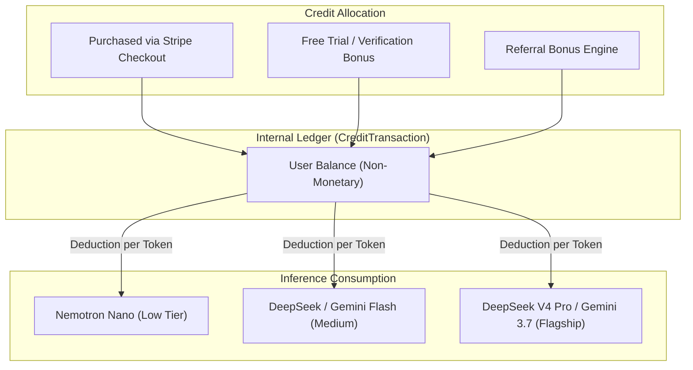

# 📜 Helpotron Terms of Service & End-User License Agreement

**Effective Date:** August 31, 2026
**Last Material Revision:** August 31, 2026
**Operating Entity:** Helpotron, LLC ("Helpotron", "Company", "we", "us", or "our")
**Corporate Address:** New Orleans, Louisiana, United States of America
**Contact Email:** `buisness@rssytemsweb.com` / `buisness@rssytemsweb.com`

---

> [!IMPORTANT]
> **PLEASE READ THESE TERMS CAREFULLY BEFORE ACCESSING OR USING THE PLATFORM.**
> THESE TERMS CONTAIN A **MANDATORY BINDING ARBITRATION AGREEMENT** AND A **CLASS ACTION WAIVER** IN SECTION 14 THAT GOVERN THE RESOLUTION OF ANY DISPUTES BETWEEN YOU AND HELPOTRON, LLC. BY ACCEPTING THESE TERMS, YOU AGREE TO RESOLVE DISPUTES EXCLUSIVELY ON AN INDIVIDUAL BASIS THROUGH BINDING ARBITRATION RATHER THAN IN COURT, AND YOU WAIVE THE RIGHT TO PARTICIPATE IN A CLASS ACTION LAWSUIT OR CLASS-WIDE ARBITRATION.

---

## 1. Acceptance of Terms & Mutual Agreement

These Terms of Service, together with our [Global Privacy Policy](file:///home/roni/Roni_workspace/helpotron/docs/PRIVACY_POLICY.md) and any applicable service addenda (collectively, the "Agreement"), constitute a legally binding contract between you (the "User", "Student", "Customer", or "you") and **Helpotron, LLC**.

By creating an account, clicking "I Agree", downloading or installing the Helpotron browser extension, purchasing compute credits, or accessing or utilizing any part of the Helpotron website ([`https://helpotron.com`](https://helpotron.com)), application programming interfaces (APIs), or associated services (collectively, the "Platform" or "Services"), you represent and warrant that:
1. You have read, understood, and agree to be bound by the terms and conditions of this Agreement;
2. You possess the legal capacity and authority to enter into this Agreement under the laws of your jurisdiction; and
3. If you are accepting these Terms on behalf of an educational institution, school district, university, or corporate entity, you possess full legal authority to bind that entity to this Agreement.

If you do not agree unconditionally to all terms and conditions of this Agreement, you are expressly prohibited from accessing or using the Services and must immediately delete your account.

---

## 2. Eligibility & Educational User Status

### 2.1 Age Threshold & Minor Restrictions
The Services are intended strictly for users who are at least **thirteen (13) years of age**. If you are under thirteen (13) years of age, you are **strictly prohibited** from registering an account, submitting personal data, or utilizing the Services under the Children's Online Privacy Protection Act (COPPA, 15 U.S.C. § 6501 et seq.).

If you are between the ages of thirteen (13) and seventeen (17) (or the age of majority in your jurisdiction of residence):
1. You represent and warrant that your parent or legal guardian has reviewed and agreed to these Terms on your behalf; and
2. Your parent or legal guardian agrees to assume full responsibility for your compliance with these Terms, including all financial transactions and compute credit purchases executed through your account.

### 2.2 Global Compliance & Sanctions
You represent and warrant that:
- You are not located in, resident in, or an agent of any country or territory subject to comprehensive United States economic sanctions (including Cuba, Iran, North Korea, Syria, and the occupied regions of Ukraine); and
- You are not listed on any United States Government list of prohibited or restricted parties, including the Treasury Department's Specially Designated Nationals (SDN) List or the Commerce Department's Entity List.

---

## 3. Account Registration, Authentication & Security

### 3.1 Account Credentials
To access core features of Helpotron, you must establish an account. You agree to provide accurate, current, and complete registration information and to promptly update your credentials to maintain accuracy.

### 3.2 Confidentiality of Credentials
You are entirely responsible for maintaining the confidentiality of your account credentials, session tokens, passwords, and multi-factor authentication devices. You agree not to disclose your password to any third party. You assume full responsibility for all activities, operations, and transactions conducted under your account credentials.

### 3.3 Two-Factor Authentication (2FA)
Helpotron provides multi-factor authentication options, including TOTP Authenticator apps (Google Authenticator, Authy) and SMS two-factor authentication via Twilio. When 2FA is active, login requires inputting a cryptographically generated single-use verification code. You agree to maintain physical custody of your designated 2FA authentication device.

### 3.4 Prompt Notification of Unauthorized Access
You agree to notify Helpotron immediately at `buisness@rssytemsweb.com` upon discovering or suspecting any unauthorized access, security breach, credential compromise, or unusual session activity associated with your account. Helpotron shall not be liable for any loss, damage, or unauthorized charges arising from your failure to safeguard your account credentials.

---

## 4. Academic Integrity, Ethical AI Utilization & Student Obligations

### 4.1 Purely Supplementary & Assistive Study Tool
Helpotron is designed, engineered, and offered exclusively as an **assistive academic study synthesizer, research accelerator, lecture transcription aid, and organizational workspace**. It is not designed or intended to circumvent academic honor codes, fabricate unearned grades, or replace the essential human intellectual work of learning.

### 4.2 Affirmative Honor Code Warranty
You represent, warrant, and covenant that:
1. You will utilize Helpotron in strict compliance with your educational institution's academic integrity policies, honor codes, student handbooks, and specific course syllabi guidelines;
2. You will **never** utilize Helpotron to generate responses during live proctored examinations, quizzes, closed-book tests, or unauthorized assessments;
3. You will not represent AI-synthesized content as entirely your own original human authorship where prohibited by institutional rules; and
4. You assume sole, non-delegable academic responsibility for ensuring that any study aids, outlines, flashcards, or drafts prepared with Helpotron assistance comply with your instructors' permissible AI utilization policies.

### 4.3 Institutional Disciplinary Indemnity
Helpotron exercises no editorial control over the homework, essays, lab reports, or exams you submit to educational institutions. **Helpotron, LLC disclaims all liability, and you agree to defend, indemnify, and hold harmless Helpotron from and against any academic reprimand, honor board hearing, grade penalty, course failure, suspension, expulsion, or institutional sanction arising from your utilization of the Services.**

---

## 5. Virtual Compute Credits & Internal Token Economy

Helpotron operates an internal virtual compute credit system ("Compute Credits" or "Tokens") to allocate computing power and manage API inference costs across multi-model AI pipelines.



### 5.1 Nature of Compute Credits — Limited Revocable License
**COMPUTE CREDITS ARE NOT CURRENCY, PROPERTY, OR LEGAL TENDER.**
Compute Credits represent a limited, non-exclusive, non-transferable, revocable, personal software license to utilize computing resources on the Platform. Compute Credits:
- Have **zero monetary value** ($0.00 USD);
- Do not earn interest, hold cash value, or constitute a deposit or banking instrument;
- Cannot be redeemed, refunded, exchanged, sold, or cashed out for fiat currency, cryptocurrencies, or external goods;
- Are strictly non-transferable between user accounts, whether by gift, sale, bequest, bankruptcy, or operation of law.

### 5.2 Consumption & Rate Schedules
Compute Credits are debited from your account balance in real-time based on token usage, model tiering (e.g., Nemotron Nano, Gemini Flash Lite, DeepSeek V4 Flash Vision, DeepSeek V4 Pro Vision), audio transcription minutes, or file processing volume. Consumption schedules are determined by Helpotron's automated routing engine and may be updated periodically to reflect underlying cloud API costs.

### 5.3 Non-Refundability & Forfeiture
All purchases of Compute Credits or paid subscriptions are **final and non-refundable**, except as required by applicable consumer protection laws. Upon voluntary account deletion (`DELETE /user/account`), suspension for terms violations, or platform termination, all unconsumed Compute Credits are immediately and permanently forfeited without compensation.

---

## 6. Commercial Transactions, Billing & Subscriptions

### 6.1 Third-Party Payment Processor (Stripe)
All payment processing on Helpotron is executed directly through **Stripe, Inc.** Helpotron does not store, process, or transmit raw credit card numbers or banking account data. By initiating a purchase or subscription, you authorize Stripe and Helpotron to charge your designated payment method for all applicable fees, taxes, and recurring billing cycles.

### 6.2 Subscription Plans & Automatic Renewal
If you subscribe to a recurring tier (e.g., Monthly Pro, Elite):
1. **Continuous Billing:** Your subscription automatically renews at the end of each billing cycle unless cancelled prior to the renewal date.
2. **Cancellation Procedure:** You may cancel your subscription at any time through the platform Settings interface. Cancellation halts future charges; access to subscription benefits continues through the end of the current paid billing period.
3. **No Prorated Refunds:** We do not provide prorated refunds or credits for partial billing periods.

### 6.3 Fee Revisions
Helpotron reserves the right to adjust subscription pricing and credit bundle rates upon thirty (30) days' advance notice delivered via email or dashboard notification. Continued subscription after the effective date of a price change constitutes agreement to the revised pricing.

### 6.4 Chargebacks & Dispute Abuse
Initiating a payment chargeback or merchant dispute without first contacting `buisness@rssytemsweb.com` constitutes a material breach of this Agreement. In the event of a chargeback, Helpotron reserves the right to immediately suspend your account, debit negative credit balances, and pursue statutory collection remedies.

---

## 7. Referral Program Rules & Anti-Abuse Standards

Helpotron may offer a referral program enabling students to earn bonus Compute Credits by introducing new users:

1. **Bona Fide Human Referrals Only:** Referral invitations may only be shared with personal acquaintances, classmates, or through personal social channels. Posting referral links on commercial coupon aggregators, search engine ad campaigns, or spamming forums is strictly prohibited.
2. **Prohibition of Self-Referrals & Sybil Attacks:** Creating multiple accounts, utilizing disposable or temporary email domains, deploying automated scripts, or verifying fictitious phone numbers to harvest referral credits constitutes criminal wire fraud and an immediate ground for permanent account termination and forfeiture of all accumulated credits.
3. **Program Discretion:** Helpotron reserves the right to investigate referral activity, withhold unearned credits, or discontinue the referral program at any time without prior notice.

---

## 8. Intellectual Property, User Content & AI Output

### 8.1 Ownership of User Content & Uploaded Coursework
You retain all preexisting intellectual property rights, copyright, and ownership in and to the coursework, lecture notes, syllabus materials, audio recordings, and text you upload, transmit, or input into Helpotron ("User Content").

### 8.2 Operational License Granted to Helpotron
To operate the Services, you grant Helpotron, LLC a worldwide, non-exclusive, royalty-free, fully-paid, sublicensable (solely to our vetted cloud and AI subprocessors) license to host, store, cache, reproduce, format, analyze, and process your User Content **solely for the purpose of delivering, optimizing, and maintaining the Services for you**. This license terminates when your User Content is deleted from the Platform.

### 8.3 Ownership of AI-Generated Synthesis & Outputs
Subject to your compliance with these Terms, Helpotron hereby assigns and transfers to you all of its right, title, and interest (if any) in and to the textual synthesis, flashcards, summaries, outlines, and code outputs generated for you by the Platform ("AI Outputs").

> [!WARNING]
> **Statutory Notice on AI Authorship:** Under United States Copyright Office guidance (88 FR 16190) and international intellectual property law, purely autonomous machine-generated content lacks human authorship and may not be copyrightable. Furthermore, because generative AI models operate stochastically, identical or substantially similar outputs may be generated for other users who submit similar prompts. Helpotron provides no representation or warranty that AI Outputs are unique, copyrightable, or free from third-party intellectual property claims.

### 8.4 Digital Millennium Copyright Act (DMCA) Notice & Takedown Policy
Helpotron respects the intellectual property rights of others and complies with the **Digital Millennium Copyright Act (17 U.S.C. § 512)**. If you believe that content hosted on the Platform infringes upon your copyright, submit a formal written notification containing the following elements to our Designated DMCA Agent:

1. Physical or electronic signature of the authorized copyright owner;
2. Identification of the copyrighted work claimed to have been infringed;
3. Identification of the material claimed to be infringing and its specific URL or location on the Platform;
4. Your contact information (name, physical address, telephone number, and email address);
5. A statement of good faith belief that the disputed use is unauthorized; and
6. A statement made under penalty of perjury that the information in the notice is accurate and that you are authorized to act on behalf of the copyright owner.

**Designated DMCA Copyright Agent:**
Helpotron, LLC
Attn: Copyright Compliance Office
Email: `buisness@rssytemsweb.com`
New Orleans, Louisiana, USA

---

## 9. Artificial Intelligence Disclaimers & Technical Limitations

```text
┌──────────────────────────────────────────────────────────────────────────┐
│                   CRITICAL AI RELIABILITY DISCLAIMER                     │
│                                                                          │
│ 1. Stochastic Output: Generative AI models generate text based on        │
│    probabilistic mathematical associations, not conscious reasoning.     │
│ 2. Hallucination Risk: Outputs may occasionally contain factual errors,  │
│    fabricated citations, outdated figures, or logical inaccuracies.      │
│ 3. Independent Verification: You MUST independently verify all dates,    │
│    mathematical calculations, scientific formulas, and factual claims.   │
│ 4. No Professional Advice: Helpotron is NOT a licensed attorney, medical │
│    doctor, financial planner, or professional engineer. Never rely on    │
│    Platform outputs for legal, healthcare, or financial decisions.       │
└──────────────────────────────────────────────────────────────────────────┘
```

### 9.1 Warranty of Accuracy Disclaimed
**HELPOTRON DOES NOT WARRANT OR GUARANTEE THE ACCURACY, COMPLETENESS, TRUTHFULNESS, OR RELIABILITY OF ANY AI OUTPUT.** You assume full and exclusive responsibility for verifying all calculations, code, essays, and study guides generated through the Services prior to academic, professional, or personal utilization.

### 9.2 Zero Liability for Model Hallucinations
Under no circumstances shall Helpotron, LLC, its members, managers, employees, affiliates, or AI subprocessors be liable for any academic grading penalties, exam failures, inaccurate research citations, lost credit, or damages arising directly or indirectly from AI model errors, hallucinations, or system downtime.

---

## 10. Prohibited Conduct & Acceptable Use Standards

You agree that you will not, under any circumstances:

1. **Circumvent Academic Controls:** Utilize the Platform to cheat, commit plagiarism, deceive educational authorities, or bypass proctoring, exam monitoring, or institutional testing safeguards;
2. **Reverse Engineer or Scrape:** Decompile, reverse engineer, disassemble, extract source code from, or scrape the Platform, browser extensions, or underlying AI dispatch logic;
3. **Security Interference:** Probe, scan, or test the vulnerability of Helpotron infrastructure, or attempt to breach authentication, authorization, or rate-limiting controls;
4. **Denial of Service & Abuse:** Saturate API gateways, flood inference endpoints with automated bulk requests, or interfere with system availability for other students;
5. **Malicious Payloads & Prompt Injections:** Transmit viruses, worms, Trojan horses, or crafted prompt injection strings intended to compromise backend model safety guardrails or extract confidential system instructions;
6. **Commercial Exploitation:** Resell, sublicense, lease, or commercially exploit access to Helpotron compute resources without express written authorization;
7. **Unlawful, Defamatory or Infringing Content:** Input or transmit content that violates copyright, privacy, or trademark rights, or that contains illegal, harassing, defamatory, or threatening material.

Violation of these standards constitutes an immediate material breach and may result in immediate account termination, forfeiture of credits, and civil or criminal prosecution.

---

## 11. Disclaimer of Warranties ("AS IS" and "AS AVAILABLE")

TO THE MAXIMUM EXTENT PERMITTED BY APPLICABLE LAW:
1. THE SERVICES, INCLUDING ALL WEB DASHBOARDS, BROWSER EXTENSIONS, COMPUTE CREDITS, AND AI OUTPUTS, ARE PROVIDED ON AN **"AS IS"** AND **"AS AVAILABLE"** BASIS, WITHOUT WARRANTIES OF ANY KIND, EITHER EXPRESS OR IMPLIED.
2. HELPOTRON, LLC AND ITS AFFILIATES, OFFICERS, DIRECTORS, EMPLOYEES, AND SUBPROCESSORS EXPRESSLY DISCLAIM ALL WARRANTIES, EXPRESS OR IMPLIED, INCLUDING BUT NOT LIMITED TO IMPLIED WARRANTIES OF **MERCHANTABILITY, FITNESS FOR A PARTICULAR PURPOSE, TITLE, ACCURACY, NON-INFRINGEMENT, AND FREEDOM FROM COMPUTER VIRUSES OR HARMFUL COMPONENTS**.
3. WE DO NOT WARRANT THAT THE SERVICES WILL MEET YOUR ACADEMIC REQUIREMENTS, OPERATE WITHOUT INTERRUPTION, BE SECURE OR ERROR-FREE, OR THAT DEFECTS WILL BE TIMELY CORRECTED.

---

## 12. Comprehensive Limitation of Liability

TO THE MAXIMUM EXTENT PERMITTED BY APPLICABLE LAW:

### 12.1 Exclusion of Consequential & Indirect Damages
IN NO EVENT SHALL HELPOTRON, LLC, ITS MEMBERS, MANAGERS, EMPLOYEES, AGENTS, SUPPLIERS, OR SUBPROCESSORS BE LIABLE TO YOU OR ANY THIRD PARTY FOR ANY **INDIRECT, INCIDENTAL, SPECIAL, CONSEQUENTIAL, PUNITIVE, OR EXEMPLARY DAMAGES**, INCLUDING DAMAGES FOR LOSS OF PROFITS, REPUTATION, ACADEMIC GOOD STANDING, DATA LOSS, DEVICE CORRUPTION, OR BUSINESS INTERRUPTION, ARISING OUT OF OR IN CONNECTION WITH THE SERVICES, EVEN IF ADVISED OF THE POSSIBILITY OF SUCH DAMAGES.

### 12.2 Aggregate Monetary Liability Cap
IN NO EVENT SHALL THE TOTAL AGGREGATE LIABILITY OF HELPOTRON, LLC ARISING OUT OF OR RELATING TO THIS AGREEMENT, REGARDLESS OF THE FORM OF ACTION (WHETHER IN CONTRACT, TORT, STRICT LIABILITY, OR STATUTORY CODE), EXCEED THE GREATER OF:
1. **ONE HUNDRED UNITED STATES DOLLARS ($100.00 USD)**; OR
2. **THE TOTAL AMOUNT PAID BY YOU TO HELPOTRON IN THE TWELVE (12) MONTHS PRECEDING THE EVENT GIVING RISE TO LIABILITY.**

THE EXISTENCE OF MORE THAN ONE CLAIM OR SUIT SHALL NOT EXPAND OR EXTEND THIS MONETARY LIMITATION.

---

## 13. Mutual Indemnification by User

You agree to defend, indemnify, and hold harmless **Helpotron, LLC**, its parents, subsidiaries, affiliates, officers, directors, members, managers, employees, and agents from and against any and all claims, liabilities, damages, losses, costs, expenses, or fees (including reasonable attorneys' fees and court costs) arising out of or relating to:
1. Your access to, use of, or misuse of the Services, browser extensions, or AI Outputs;
2. Your violation of this Agreement, institutional honor codes, student handbooks, or applicable laws;
3. Your infringement of any intellectual property, privacy, or proprietary right of any third party;
4. Any dispute between you and any educational institution, professor, grader, or academic administration concerning assignments processed through the Services.

Helpotron reserves the right to assume the exclusive defense and control of any matter subject to indemnification by you, at your expense, and you agree to cooperate fully with our defense.

---

## 14. Binding Mandatory Arbitration & Class Action Waiver

```text
┌──────────────────────────────────────────────────────────────────────────┐
│              BINDING INDIVIDUAL ARBITRATION NOTICE                       │
│                                                                          │
│ By accepting these Terms, you agree that all disputes between you and    │
│ Helpotron, LLC will be resolved exclusively through final and binding    │
│ individual arbitration administered by the American Arbitration          │
│ Association (AAA), rather than in a court of law.                        │
│                                                                          │
│ YOU AND HELPOTRON EXPRESSLY WAIVE ANY RIGHT TO A JURY TRIAL AND WAIVE    │
│ ANY RIGHT TO PARTICIPATE AS A CLASS REPRESENTATIVE OR CLASS MEMBER IN    │
│ ANY CLASS, COLLECTIVE, MASS, OR REPRESENTATIVE PROCEEDING.               │
└──────────────────────────────────────────────────────────────────────────┘
```

### 14.1 Informal Dispute Resolution
Prior to filing any arbitration demand, you and Helpotron agree to attempt in good faith to resolve the dispute informally. You must send written notice describing the dispute to `buisness@rssytemsweb.com`. If the dispute is not resolved within sixty (60) days of receipt, either party may commence formal arbitration proceedings.

### 14.2 Arbitration Rules & Forum
Any unresolved dispute, claim, or controversy arising out of or relating to this Agreement or the breach, termination, enforcement, interpretation, or validity thereof shall be determined by final and binding individual arbitration before a single neutral arbitrator administered by the **American Arbitration Association (AAA)** in accordance with its Consumer Arbitration Rules. The arbitration shall take place in **New Orleans, Louisiana**, or may be conducted virtually by videoconference upon mutual agreement.

### 14.3 Class Action Waiver
**YOU AND HELPOTRON AGREE THAT EACH PARTY MAY BRING CLAIMS AGAINST THE OTHER ONLY IN AN INDIVIDUAL CAPACITY AND NOT AS A PLAINTIFF OR CLASS MEMBER IN ANY PURPORTED CLASS, COLLECTIVE, OR REPRESENTATIVE ACTION.** The arbitrator shall have no authority to consolidate claims or administer class arbitration.

### 14.4 Statutory Carve-Outs
Notwithstanding the foregoing, both parties retain the right to:
1. Bring an individual claim in small claims court within Orleans Parish, Louisiana; and
2. Seek emergency provisional injunctive relief in a court of competent jurisdiction to prevent the actual or threatened infringement, misappropriation, or violation of intellectual property rights or trade secrets.

### 14.5 Thirty (30) Day Arbitration Opt-Out Right
You have the right to opt out of the provisions of this Arbitration Agreement by sending written notice of your decision to opt out to `buisness@rssytemsweb.com` within **thirty (30) days** of first registering your account. The notice must include your full legal name, public ID, email address, and an unambiguous statement expressing your intent to opt out of binding arbitration. If you opt out, all other provisions of these Terms remain fully binding.

---

## 15. Term, Suspension & Termination

1. **Term:** This Agreement remains in full force and effect while you maintain an account or access the Services.
2. **Termination by User:** You may terminate this Agreement at any time by permanently deleting your account via the self-service erasure endpoint (`DELETE /user/account`).
3. **Suspension & Termination by Helpotron:** Helpotron reserves the right, in its sole and absolute discretion, to suspend or terminate your account, revoke Compute Credits, and block access to the Services immediately, without prior notice or liability, for any reason, including:
   - Breach of these Terms, academic integrity policies, or acceptable use rules;
   - Suspected fraudulent, abusive, or illegal activity;
   - Discontinuation or material modification of the Platform.
4. **Survival:** Sections 4, 5, 8, 9, 11, 12, 13, 14, 16, and 17 shall survive any termination or expiration of this Agreement.

---

## 16. Governing Law & Exclusive Venue

This Agreement, and all claims or causes of action (whether in contract, tort, or statute) arising out of or relating to this Agreement, shall be governed by, construed, and enforced in accordance with the laws of the **State of Louisiana, United States of America**, without giving effect to any principles of conflicts of law that would require the application of the laws of another jurisdiction.

To the extent that any dispute is not subject to arbitration under Section 14, you and Helpotron irrevocably submit to the exclusive personal jurisdiction and venue of the state and federal courts located in **Orleans Parish, Louisiana** (including the United States District Court for the Eastern District of Louisiana), and waive any objection as to inconvenient forum.

---

## 17. General Contractual Provisions

1. **Entire Agreement:** This Agreement, together with the Global Privacy Policy and any written addenda, constitutes the entire agreement between you and Helpotron, LLC regarding the Services, superseding all prior oral or written communications, proposals, or representations.
2. **Severability:** If any provision of this Agreement is held to be invalid, illegal, or unenforceable by an arbitrator or court of competent jurisdiction, such provision shall be enforced to the maximum extent permissible, and the remaining provisions shall continue in full force and effect.
3. **Waiver:** No waiver of any term of this Agreement shall be deemed a further or continuing waiver of such term or any other term, and Helpotron's failure to assert any right under this Agreement shall not constitute a waiver of such right.
4. **Assignment:** You may not assign, transfer, or delegate this Agreement or any rights granted herein without Helpotron's prior written consent. Helpotron may assign this Agreement freely in connection with a corporate reorganization, merger, acquisition, or sale of assets.
5. **Force Majeure:** Helpotron shall not be liable for any failure or delay in performance resulting from causes beyond its reasonable control, including acts of God, telecommunications or cloud infrastructure failures, power outages, labor strikes, civil unrest, war, governmental orders, or distributed denial of service attacks.
6. **Statutory Notices & Contact:** Formal legal notices to Helpotron must be delivered in writing to `buisness@rssytemsweb.com`.
