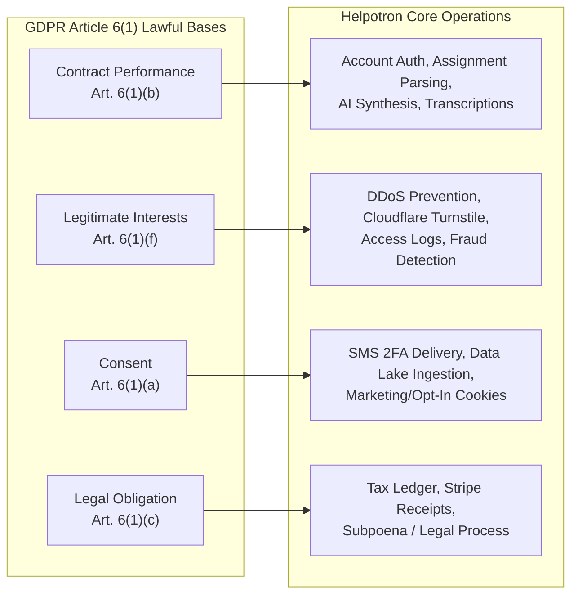
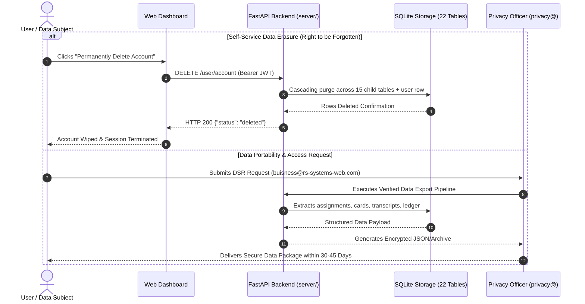

# 🛡️ Helpotron Global Privacy Policy & Statutory Data Protection Disclosure

**Effective Date:** August 31, 2026
**Last Material Revision:** August 31, 2026
**Operating Entity:** Helpotron, LLC ("Helpotron", "Company", "we", "us", or "our")
**Registered DPO / Privacy Contact:** `buisness@rs-systems-web.com`
**Governing Jurisdiction:** State of Louisiana, United States of America

---

> [!NOTE]
> **Summary for Students and Users:** We believe in absolute transparency. Helpotron is an autonomous study synthesizer, research assistant, and educational operating system. We collect only the data necessary to provide personalized study materials, transcribe lectures, manage account security (including optional SMS two-factor authentication), and operate our platform. **We do not sell your personal information, we do not share your study materials with data brokers, and we do not use your coursework to train external public foundation AI models.**

---

## 1. Introduction, Scope & Identity of the Data Controller

This Global Privacy Policy ("Policy") governs the collection, storage, use, disclosure, transfer, and protection of personal information by **Helpotron, LLC** across all user interactions with our web platform ([`https://helpotron.dpdns.org`](https://helpotron.dpdns.org)), application programming interfaces (APIs), the Helpotron browser extensions (including the Chrome Web Store extension), desktop utilities, and mobile/remote interfaces (collectively, the "Platform" or "Services").

For individuals located within the European Economic Area ("EEA"), the United Kingdom ("UK"), or Switzerland, Helpotron, LLC acts as the **Data Controller** under Regulation (EU) 2016/679 (General Data Protection Regulation or "GDPR") and the UK Data Protection Act 2018 ("UK GDPR"), unless our Services are procured by an educational institution under a signed enterprise institutional contract, in which case the educational institution acts as the Data Controller and Helpotron acts as the Data Processor.

By accessing or utilizing Helpotron, you acknowledge that you have read, understood, and agree to the data collection and processing practices described herein. If you do not agree with this Policy, you must immediately terminate access and discontinue use of the Services.

---

## 2. Granular Personal Data Category Inventory

We systematically categorize the personal information collected, processed, and maintained in our database infrastructure:

| Category Code | Category Description | Specific Data Elements | System Location & Storage | Primary Collection Source |
|---|---|---|---|---|
| **CAT-01** | **Account Credentials & Identity** | Unique Public ID (`public_id`), username, email address, password hash (salted `scrypt`/`PBKDF2-HMAC-SHA256`), Telegram ID (optional), role designation (`admin`, `moderator`, `member`), account creation and update timestamps. | Database Table: `users`, `user_sessions` | Directly provided by user upon registration or account update. |
| **CAT-02** | **Authentication & Multi-Factor Secrets** | Session JSON Web Tokens (`HS256`/`RS256`), device user-agent hashes, IP binding fingerprints, Time-Based One-Time Password (TOTP) seed secrets (`pyotp`), temporary password reset tokens (15-minute TTL). | Database Table: `users`, `password_resets`, Memory Store | System-generated upon authentication and 2FA enrollment. |
| **CAT-03** | **Telephony & 2FA Contact Signals** | E.164-formatted mobile phone numbers, single-use 6-digit SMS verification OTPs (15-minute TTL), cryptographic hashes of phone numbers for trial abuse prevention (`claimed_trial_phones`), delivery status receipts. | Database Table: `claimed_trial_phones`, In-Memory OTP Store | Directly provided by user when opting into SMS 2FA or free trial verification. |
| **CAT-04** | **Academic Coursework & Assignment Context** | Course names, instructor/teacher names, Canvas assignment identifiers, assignment titles, submission deadlines, grading scales, rubrics, raw HTML prompt text, extracted textual instructions, target word counts. | Database Table: `assignments`, `universal_dump_items` | Directly entered by user, uploaded via files, or extracted locally via browser extension from user-authorized LMS sessions. |
| **CAT-05** | **User Study Notes & Synthesis Artifacts** | Flashcard question-answer decks, practice exams, study guides, outlines, writing drafts, revision histories, Anki-compatible packages (`.apkg`), synthesized lecture notes. | Database Table: `study_materials`, `drafts` | System-generated via user-prompted AI synthesis and direct user edits. |
| **CAT-06** | **Audio Recordings & Transcripts** | User-uploaded lecture audio files, streaming voice recordings, automated text transcriptions, AI-generated lecture chapter markers, speaker diarization tags, audio duration. | Database Table: `transcripts`, Object Storage pointers | Directly uploaded or recorded by the user during study or lecture sessions. |
| **CAT-07** | **Interactive Agent Dialogues & Directives** | Chat messages with "My Agent", multi-turn conversation threads, prompt tokens, completion tokens, autonomous tool execution history, custom persona system instructions. | Database Table: `agent_chat_threads`, `agent_chat_messages`, `agent_actions` | Generated dynamically during interactive sessions between user and AI agent. |
| **CAT-08** | **Knowledge Assets & Workspace Files** | User-uploaded reference documents (`.pdf`, `.docx`, `.txt`, `.py`, `.md`), custom agent skill configurations, persistent memory documents, personal style guidelines. | Database Table: `agent_files`, Local Workspace Cache | Uploaded directly by user into the agent workspace. |
| **CAT-09** | **Hierarchical User Preferences** | Configuration parameters across the 7-tier scoping cascade (`task`, `assignment`, `teacher`, `class`, `subject`, `academic`, `global`), notification toggles, theme preferences. | Database Table: `user_settings`, `user_settings_scopes` | Configured by user through Settings and Control Center interfaces. |
| **CAT-10** | **Billing & Commercial Ledger** | Stripe Customer ID, Stripe Subscription ID, checkout transaction tokens, payment amount, currency, transaction status, billing country, internal virtual microcredits balance (`credits`), credit ledger audit entries. *(Note: Full credit card numbers and CVVs are processed directly by Stripe and never touch Helpotron servers).* | Database Table: `payments`, `credit_transactions` | Generated upon commercial checkout via Stripe integration. |
| **CAT-11** | **Referral & Growth Tracking** | Unique referral codes, referring user IDs, referee user IDs, redemption timestamps, credit bonus attribution status. | Database Table: `referrals` | Generated upon invocation of platform referral links. |
| **CAT-12** | **Collaborative Study Groups** | Study group titles, institutional class tags, membership rosters, shared flashcard sets, collaborative study session timestamps. | Database Table: `study_groups`, `group_memberships`, `shared_materials` | Created and populated by users engaging in collaborative study features. |
| **CAT-13** | **Institutional Organization Mapping** | Organization name, domain suffix, seat allocation quotas, institutional administrator user ID, institutional policy flags. | Database Table: `organizations` | Provided by institutional purchasers or school group organizers. |
| **CAT-14** | **Data Lake Contributions (Opt-In Only)** | Anonymized academic writing samples, humanizer quality ratings, structural syntax patterns. All direct personal identifiers (names, emails, student IDs) are scrubbed prior to ingestion. | Database Table: `data_submissions` | Explicitly and voluntarily submitted by users opting into the research data lake. |
| **CAT-15** | **Browser Extension Context Signals** | Active browser tab origin (`canvas.instructure.com` or Google Docs), visible DOM assignment containers, cursor positioning events, simulated keystroke pacing parameters. | Local Browser Storage / Chrome Extension Session | Read locally by the Chrome Extension from user-navigated active browser tabs. |
| **CAT-16** | **Technical Telemetry, Network & Security Logs** | Truncated client IP address, HTTP request method, endpoint URL, HTTP response status, execution duration in milliseconds, User-Agent header, Cloudflare Turnstile verification tokens, rotating server access log entries. | Database Table: `api_usage_logs`, System Rotating Logs | Automatically recorded by edge servers (Cloudflare) and application gateways during API requests. |

---

## 3. Lawful Bases for Processing (GDPR Article 6 & UK GDPR)

Under European and UK data protection frameworks, every processing operation conducted by Helpotron is justified by an established legal basis under **GDPR Article 6(1)**:



1. **Performance of a Contract (GDPR Art. 6(1)(b)):** Processing necessary to create your account, authenticate sessions, extract assignment criteria, synthesize study notes, manage compute credits, and execute core application features requested by you.
2. **Legitimate Interests (GDPR Art. 6(1)(f)):** Processing necessary to protect system integrity, defend against Distributed Denial of Service (DDoS) attacks, detect bot abuse via Cloudflare Turnstile, debug application errors, prevent trial credit arbitrage, and optimize application latency. We balance these interests against your fundamental privacy rights.
3. **Explicit Consent (GDPR Art. 6(1)(a)):** Processing based on affirmative, informed consent, including:
   - Enrollment in SMS Two-Factor Authentication under TCPA and CTIA standards.
   - Voluntary submission of anonymized writing samples into the Helpotron Data Lake.
   - Non-essential client-side analytical cookie storage.
   *(You maintain the statutory right to withdraw consent at any time without affecting the lawfulness of prior processing).*
4. **Compliance with Legal Obligations (GDPR Art. 6(1)(c)):** Retention of commercial transaction logs, VAT/sales tax metadata, and payment records for statutory periods prescribed by financial, tax, and corporate accounting laws.

---

## 4. Third-Party Subprocessor & Vendor Schedule

Helpotron integrates specialized third-party cloud infrastructure providers ("Subprocessors") to deliver high-availability AI inference, edge security, telephony, and billing. All subprocessors are vetted for compliance with GDPR Article 28 and maintain Data Processing Agreements (DPAs) with standard contractual safeguards.

| Vendor / Subprocessor | Corporate Identity & Headquarters | Role in Processing | Data Categories Transferred | Data Location | Safeguard & Transfer Mechanism |
|---|---|---|---|---|---|
| **OpenRouter, Inc.** | OpenRouter, Inc.<br>San Francisco, CA, USA | AI Inference Gateway & Routing Dispatch | Coursework prompts, assignment instructions, user chat text, token allocation limits. | United States | Standard Contractual Clauses (SCCs); Zero Data Retention (ZDR) routing terms. |
| **DeepSeek AI** | DeepSeek Technology Co.<br>US Cloud Gateway / Global | Mathematical Reasoning, Code Synthesis & Analytical Planning | Anonymized math problems, programming syntax, synthesis instructions. | United States / Distributed Cloud | Enterprise API Terms with strict no-training and confidential processing covenants. |
| **Google Cloud (Vertex AI / Gemini)** | Google LLC<br>Mountain View, CA, USA | Multimodal Vision OCR & High-Fidelity Audio Transcription | Uploaded lecture audio, assignment images/diagrams for OCR extraction. | United States | EU-US Data Privacy Framework (DPF); ISO 27001; SOC 2 Type II; SCCs. |
| **Cloudflare, Inc.** | Cloudflare, Inc.<br>San Francisco, CA, USA | Edge CDN, Web Application Firewall (WAF), DDoS Mitigation, Turnstile Captcha | Client IP address, HTTP headers, TLS fingerprint, Turnstile bot verification challenges. | Global Edge Network (Anycast) | EU-US DPF certified; SOC 2 Type II; ISO 27701; Standard Contractual Clauses. |
| **Twilio Inc.** | Twilio Inc.<br>San Francisco, CA, USA | SMS Two-Factor Authentication Delivery (A2P 10DLC) | E.164 mobile phone number, 6-digit numeric verification OTP. | United States | Twilio Binding Corporate Rules (BCRs); EU-US DPF; Standard Contractual Clauses. |
| **Stripe, Inc.** | Stripe, Inc.<br>San Francisco, CA, USA / Dublin, Ireland | Payment Card Processing, Subscription Billing & Fraud Defense | Billing name, email, payment card token, billing zip, transaction history. | United States & Ireland | PCI-DSS Level 1 Service Provider; EU-US DPF certified; Binding Corporate Rules. |

### **Zero Public Foundation Model Training Guarantee:**
Helpotron contractually requires our API inference subprocessors (OpenRouter, DeepSeek, Google Cloud) to operate under **Zero Data Retention / Zero Model Training** agreements. Your uploaded coursework, assignment instructions, lecture recordings, and interactive chat dialogues are **never** utilized to train, retrain, fine-tune, or adjust the weights of public foundation artificial intelligence models.

---

## 5. Client-Side Storage, Cookies & Local State Technologies

Helpotron operates on a privacy-first frontend architecture that minimizes cookie footprint in favor of localized browser storage. We do not deploy third-party advertising tracking pixels (e.g., Meta Pixel, Google AdSense, TikTok Pixel).

| Storage Mechanism | Identifier / Key Name | Category | Purpose & Description | Expiration / Lifespan |
|---|---|---|---|---|
| **LocalStorage** | `helpotron_token` | Strictly Necessary | Stores active JSON Web Token (JWT) authorizing API requests for the logged-in session. | Persistent until user logs out or clears browser data. |
| **LocalStorage** | `helpotron_user` | Strictly Necessary | Caches user profile metadata (public ID, current plan, remaining credits balance). | Persistent until session refresh or logout. |
| **LocalStorage** | `helpotron_theme` | Functional | Remembers UI visual presentation preferences (dark mode vs. light mode). | 1 Year. |
| **LocalStorage** | `helpotron_cookie_consent` | Strictly Necessary | Records user acknowledgment of the statutory cookie and privacy disclosure. | 1 Year. |
| **SessionStorage** | `helpotron_active_tab` | Functional | Tracks current workspace navigation view (e.g., Assignments, My Agent, Settings). | Discarded when browser tab is closed. |
| **Cloudflare Cookie** | `__cf_bm` | Strictly Necessary (Security) | Cloudflare bot management cookie utilized to differentiate human users from automated malicious bots. | 30 Minutes. |
| **Cloudflare Cookie** | `cf_clearance` | Strictly Necessary (Security) | Stores proof that a client successfully solved a Cloudflare Turnstile challenge. | Max 1 Year. |

You can manage or disable cookies and local storage through your browser settings. Note that disabling strictly necessary storage (such as `helpotron_token`) will prevent you from authenticating or utilizing the Services.

---

## 6. Telephony, SMS Two-Factor Authentication & TCPA / A2P 10DLC Compliance

Helpotron provides an optional SMS Two-Factor Authentication ("SMS 2FA") security feature to protect student accounts and verify single-use promotional free trials. We strictly comply with the **Telephone Consumer Protection Act (TCPA, 47 U.S.C. § 227)**, CTIA Messaging Principles, and carrier A2P 10DLC regulations:

```text
┌──────────────────────────────────────────────────────────────────────────┐
│                   MANDATORY SMS DISCLOSURE STATEMENT                    │
│                                                                          │
│ 1. Purpose: Phone numbers are collected EXCLUSIVELY to deliver 6-digit   │
│    security authentication codes (2FA) and verify account ownership.     │
│ 2. Non-Marketing Guarantee: Helpotron NEVER sends promotional texts,     │
│    telemarketing offers, or automated sales messages via SMS.            │
│ 3. Frequency: Message frequency depends on user login activity (1 text   │
│    per 2FA challenge).                                                   │
│ 4. Rates: Standard message and data rates may apply per your carrier.    │
│ 5. STOP / Opt-Out: Text STOP to cancel at any time.                      │
│ 6. HELP / Support: Text HELP for customer support or email               │
│    buisness@rs-systems-web.com.                                                │
│ 7. Carriers: Wireless carriers are not liable for delayed messages.     │
└──────────────────────────────────────────────────────────────────────────┘
```

### Express Written Consent Language:
By entering your mobile phone number and clicking **"Enable SMS 2FA"** or **"Verify Phone"**, you provide your express written consent authorizing Helpotron, LLC to transmit automated single-use SMS verification codes to the provided phone number via Twilio. Consent is not a condition of purchasing any paid service; users may alternatively elect TOTP Authenticator app verification (Google Authenticator, Authy) at zero cost.

---

## 7. EU Artificial Intelligence Act & Automated Processing Disclosures

In compliance with **Article 50 of the European Union Artificial Intelligence Act (Regulation (EU) 2024/1689)** and evolving consumer transparency mandates:

1. **Synthetic Content Generation Notice:** When you interact with Helpotron's "My Agent" workspace, generate flashcards, request assignment outlines, or summarize lecture audio, you are interacting with artificial intelligence systems that generate synthetic text and summaries.
2. **Human Oversight & Academic Use:** Helpotron is an assistive educational tool designed for personal study, review, and learning acceleration. It is **not** an autonomous submission engine. You maintain ultimate editorial responsibility and human oversight over all coursework, papers, and assignments submitted to educational institutions.
3. **No High-Risk Autonomous Profiling:** Helpotron does **not** make legal, credit, medical, employment, or academic admission decisions concerning you. No automated profiling produces legal or similarly significant effects under GDPR Article 22.

---

## 8. Multi-State United States Consumer Privacy Rights

If you are a resident of California, Colorado, Connecticut, Virginia, Utah, Oregon, Texas, Delaware, New Jersey, or other states with enacted comprehensive privacy laws, you possess specific statutory rights regarding your personal data:

| State Privacy Statute | Core Statutory Rights Granted | Helpotron Compliance Mechanism |
|---|---|---|
| **California Consumer Privacy Act (CCPA / CPRA, Cal. Civ. Code § 1798.100 et seq.)** | Right to Know, Delete, Correct, Opt-Out of Sale/Share, Limit Sensitive Personal Info, Non-Discrimination. | Self-service deletion (`DELETE /user/account`), data export, strict **NO SALE** and **NO SHARING** policy. |
| **Virginia Consumer Data Protection Act (VCDPA, Va. Code § 59.1-575 et seq.)** | Access, Correct, Delete, Data Portability, Opt-Out of Targeted Advertising/Profiling. | Self-service account dashboard controls; formal appeal procedure via `buisness@rs-systems-web.com`. |
| **Colorado Privacy Act (CPA, C.R.S. § 6-1-1301 et seq.)** | Access, Correct, Delete, Portability, Universal Opt-Out Mechanism recognition. | Global Privacy Control (GPC) signal honor; verified consumer request workflow. |
| **Connecticut Data Privacy Act (CTDPA, Conn. Gen. Stat. § 42-515 et seq.)** | Access, Correct, Delete, Portability, Opt-out of targeted ads/profiling. | Comprehensive DSR fulfillment within 45 days. |
| **Utah Consumer Privacy Act (UCPA, Utah Code § 13-61-101 et seq.)** | Access, Delete, Portability, Opt-out of sale or targeted advertising. | Strict internal segregation preventing commercial data monetization. |
| **Texas Data Privacy & Security Act (TDPSA, Tex. Bus. & Com. Code § 541.001 et seq.)** | Access, Correct, Delete, Portability, Opt-out of sale/targeted ads. | Verified identity request pipeline; no sale of biometric or student data. |
| **Oregon Consumer Privacy Act (OCPA, ORS § 646A.570 et seq.)** | Access list of specific third parties, Delete, Correct, Portability. | Explicit Subprocessor Directory published in Section 4 of this Policy. |

### Statutory Declaration Regarding "Sale" and "Sharing":
Helpotron **does not sell** your personal information, coursework, transcripts, or telephone numbers for monetary consideration. Furthermore, Helpotron **does not share** your personal information for cross-context behavioral advertising under CCPA/CPRA. We have not sold or shared consumer personal information in the preceding twelve (12) months.

---

## 9. Educational Privacy & Protection of Minors

### Children's Online Privacy Protection Act (COPPA, 15 U.S.C. § 6501 et seq.):
Helpotron is directed to high school, college, university, and adult professional students. The platform is **strictly prohibited to children under the age of thirteen (13)**. We do not knowingly solicit, collect, or process personal data from children under 13. If we discover that an account has been registered by a child under 13 without verified parental consent, we immediately terminate the account and purge all associated records.

### Family Educational Rights and Privacy Act (FERPA, 34 CFR Part 99):
Helpotron is a private study productivity software provided directly to the individual student user. In the standard direct-to-consumer deployment, Helpotron is **not** an educational agency or institution subject to direct FERPA governance, nor does Helpotron receive education records directly from educational institutions. When you upload or import assignment prompts, syllabus requirements, or course materials from Canvas LMS, you warrant and represent that you have the legal right to utilize such materials for your own personal educational review under Fair Use principles.

When Helpotron contracts directly with an educational institution, school district, or university ("Institutional Agreement"), Helpotron acts as an authorized "School Official" with legitimate educational interests pursuant to **34 CFR § 99.31(a)(1)(i)**, operating strictly under institutional oversight and student record confidentiality agreements.

---

## 10. Data Subject Rights & Fulfillment Procedure

Regardless of your geographic location, Helpotron provides automated self-service and manual fulfillment mechanisms to exercise your data subject rights:



### 1. Right to Erasure / Account Deletion (GDPR Art. 17 / CCPA § 1798.105):
You can execute an immediate, cascading erasure of your entire account footprint at any time directly through the platform:
- **Endpoint:** `DELETE /user/account` (requires authenticated session JWT).
- **Scope of Deletion:** Immediately cascades across and deletes all assignments, transcripts, flashcards, study groups, chat dialogues, agent customization files, drafts, referral links, and your core user record.
- **Backup Lifecycle:** Routine encrypted database snapshots are rotated and permanently purged within thirty (30) days.

### 2. Right to Access & Portability (GDPR Art. 15, 20 / CCPA § 1798.100):
You may request an export of all personal data held in our systems in structured, machine-readable format (JSON and Markdown) by emailing `buisness@rs-systems-web.com`. Verification of account ownership is required.

### 3. Response Timelines & Verification:
We acknowledge receipt of verifiable consumer requests within ten (10) business days and fulfill substantive requests within thirty (30) days (for GDPR/UK GDPR) or forty-five (45) days (for US state privacy laws). We do not discriminate against any student for exercising their statutory privacy rights.

---

## 11. Data Security Standards & Incident Response Framework

Helpotron maintains rigorous administrative, physical, and technical safeguards designed to protect personal data against accidental loss, unauthorized access, destruction, and alteration:

1. **Encryption Standards:**
   - **Data in Transit:** Enforced exclusively via **TLS 1.3** cryptographic protocols with HTTP Strict Transport Security (HSTS) preloading.
   - **Data at Rest:** Encrypted storage volumes utilizing **AES-256** encryption for all persistent database records and object storage.
   - **Password Security:** Credentials hashed using modern, memory-hard key derivation functions (`scrypt`/`PBKDF2`) utilizing cryptographically unique per-user salts.
2. **Access Control & Least Privilege:** System access is restricted to authorized engineering personnel subject to strict non-disclosure obligations, multi-factor authentication, and audited role-based access controls (RBAC).
3. **Statutory Incident & Breach Notification:** In the event of a confirmed security incident resulting in unauthorized exposure or compromise of unencrypted personal data:
   - We notify competent supervisory authorities within **seventy-two (72) hours** of becoming aware of the breach pursuant to **GDPR Article 33**.
   - We notify affected users without undue delay where the breach presents a high risk to individual rights and freedoms, or as mandated by applicable US state data breach notification statutes (including La. R.S. § 51:3071 et seq.).

---

## 12. Cross-Border International Data Transfers

Helpotron is based in the United States and utilizes cloud infrastructure located primarily within the United States. If you access the Services from the European Economic Area, United Kingdom, Switzerland, or other jurisdictions with cross-border data transfer restrictions, your information will be transferred to and processed within the United States.

We ensure an adequate level of data protection for international transfers through:
- Utilization of the **European Commission Standard Contractual Clauses (SCCs)** pursuant to Commission Implementing Decision (EU) 2021/914, incorporating the UK International Data Transfer Addendum where applicable.
- Integration of Subprocessors certified under the **EU-U.S. Data Privacy Framework (EU-U.S. DPF)** and the UK Extension to the EU-U.S. DPF.
- Technical supplementary measures, including end-to-end encryption in transit and tokenization of sensitive identifiers.

---

## 13. Policy Modifications & Statutory Notices

We reserve the right to modify this Policy periodically to reflect enhancements to platform capabilities, subprocessor additions, or legislative changes. When material modifications occur:
- We will update the "Effective Date" at the top of this document.
- We will provide prominent notice through the web application interface, an email notification to registered account holders, or an administrative dashboard alert at least thirty (30) days prior to the effective date of material changes.
- Continued access to or use of Helpotron following the effective date constitutes acknowledgment and acceptance of the revised Policy.

---

## 14. Data Protection Officer & Regulatory Contact

For privacy inquiries, statutory data subject requests, or questions regarding our data governance architecture, contact our Data Protection Officer:

**Helpotron, LLC — Data Governance & Privacy Office**
- **Email:** `buisness@rs-systems-web.com`
- **Mailing Address:** Helpotron, LLC, Legal Department, New Orleans, Louisiana, USA
- **Supervisory Authority Inquiries:** If you are located in the EEA or UK and believe our processing infringes upon your statutory rights, you possess the right to lodge a formal complaint with your local Data Protection Authority (e.g., the CNIL in France, the BfDI in Germany, or the Information Commissioner's Office in the UK).
